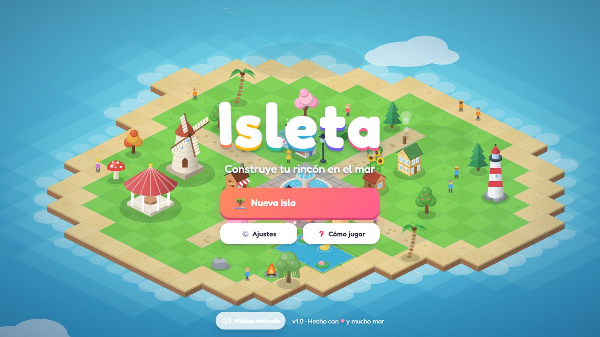
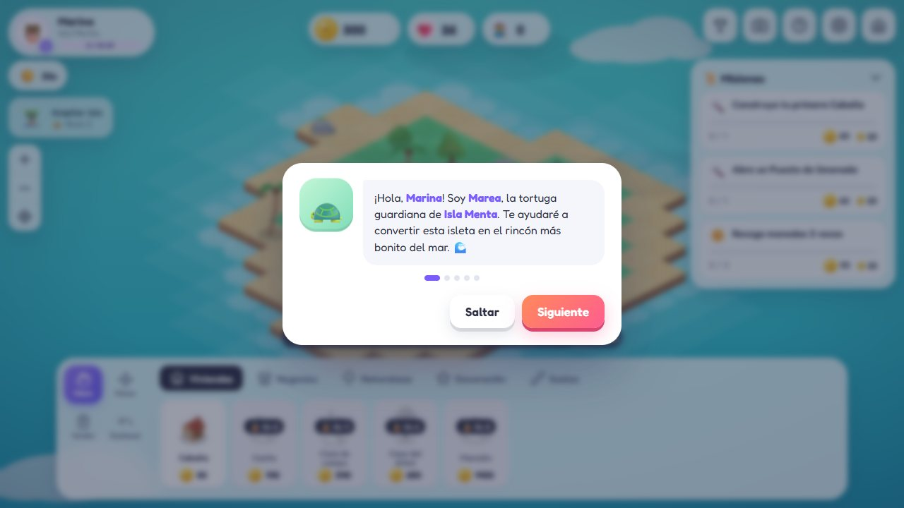

<a href="README.md">Español</a> · <b>English</b>

# Isleta 🏝️

**Build your own little corner of the sea.** A cozy game about building and decorating your own island, in the browser.

## What it is

You arrive at an almost empty islet, and Marea, the guardian turtle, helps you turn it into the nicest spot in the sea. You build houses and businesses, plant nature, decorate, change the ground and complete quests to earn coins and attract neighbors.

## How to play

- **In the browser:** go to **[virtuanista.github.io/isleta](https://virtuanista.github.io/isleta/)**. It also works on mobile.
- **Offline:** download the repository and double-click `index.html`. Nothing to install.

The game saves itself to the browser's local storage, and you can have several islands.

## What's in the game

- **More than 40 items** to build, in 5 categories: homes, businesses, nature, decoration and floors.
- **Tools** to move, rotate, change the ground and remove items.
- **Customize your island**: avatar, name and style: Primavera (Spring), Tropical or Otoño (Autumn).
- **Quests** that guide you and give you coins and experience.
- **Day and night cycle**, music and effects.

## Technical notes

- **Not a single image or sound file**: the island, buildings and characters are drawn with Canvas 2D in isometric perspective, and the music and effects are synthesized with Web Audio.
- **No dependencies and no build step**: plain HTML, CSS and JavaScript, split into `js/data.js` (catalog), `js/draw.js` (drawing), `js/game.js` (engine and saving), `js/ui.js` (interface) and `js/audio.js` (sound).

## License

Original code, art and sound, released under the [MIT](LICENSE) license. The Fredoka typeface (SIL Open Font License) is loaded from Google Fonts.

	Repository made by <a href="https://github.com/virtuanista" target="_blank">virtu 🎣</a>

	

	Copyright &copy; 2026

	

