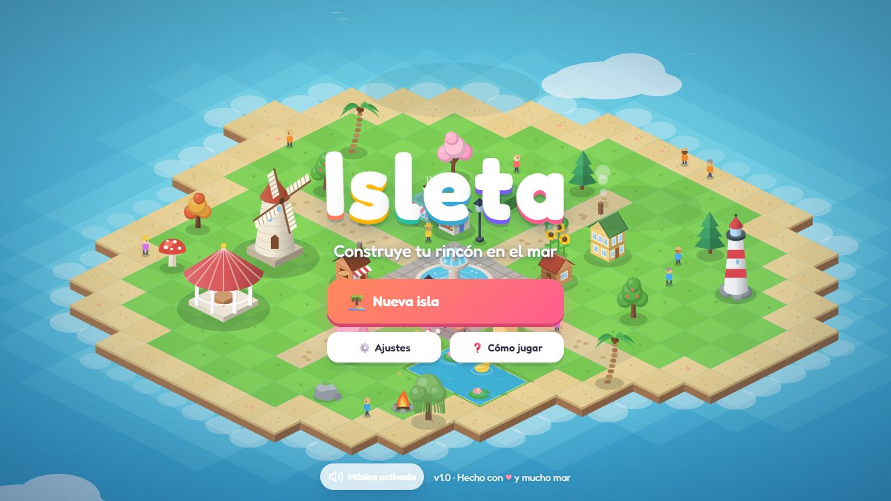
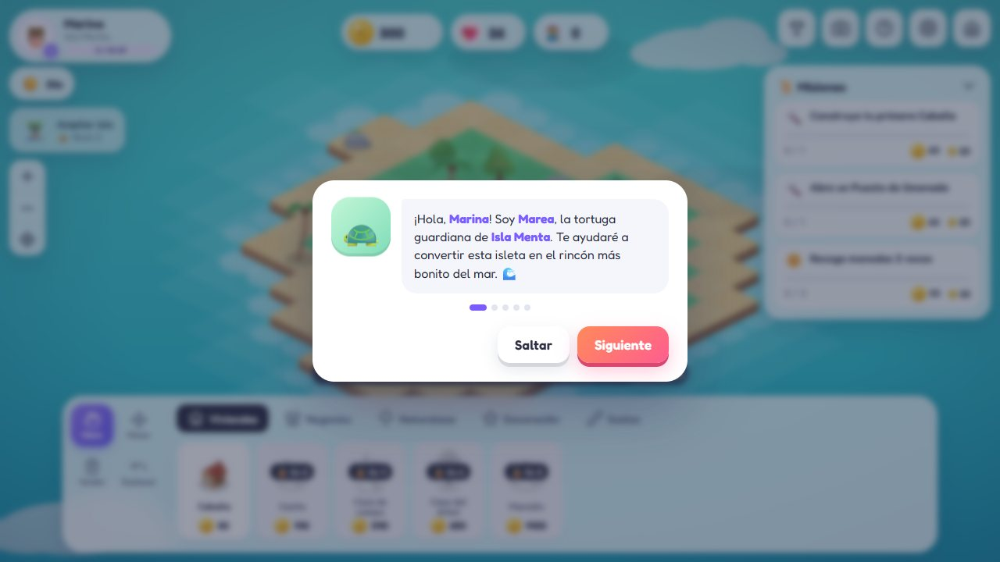

<b>Español</b> · <a href="README.en.md">English</a>

# Isleta 🏝️

**Construye tu rincón en el mar.** Un juego acogedor de construir y decorar tu propia isla, en el navegador.

## Qué es

Llegas a una isleta casi vacía y Marea, la tortuga guardiana, te ayuda a convertirla en el rincón más bonito del mar. Construyes casas y negocios, plantas naturaleza, decoras, cambias los suelos y completas misiones para ganar monedas y atraer vecinos.

## Cómo jugar

- **En el navegador:** entra en **[virtuanista.github.io/isleta](https://virtuanista.github.io/isleta/)**. También funciona en el móvil.
- **Sin conexión:** descarga el repositorio y abre `index.html` con doble clic. No hace falta instalar nada.

La partida se guarda sola en el almacenamiento local del navegador, y puedes tener varias islas.

## Contenido

- **Más de 40 elementos** para construir, en 5 categorías: viviendas, negocios, naturaleza, decoración y suelos.
- **Herramientas** para mover, rotar, cambiar los suelos y quitar elementos.
- **Personaliza tu isla**: avatar, nombre y estilo (Primavera, Tropical u Otoño).
- **Misiones** que te guían y te dan monedas y experiencia.
- **Ciclo de día y noche**, música y efectos.

## Curiosidades técnicas

- **Ni una imagen ni un archivo de sonido**: la isla, los edificios y los personajes se dibujan con Canvas 2D en perspectiva isométrica, y la música y los efectos se sintetizan con Web Audio.
- **Sin dependencias ni compilación**: HTML, CSS y JavaScript a pelo, repartidos en `js/data.js` (catálogo), `js/draw.js` (dibujo), `js/game.js` (motor y guardado), `js/ui.js` (interfaz) y `js/audio.js` (sonido).

## Licencia

Código, arte y sonido originales, publicados con licencia [MIT](LICENSE). La tipografía Fredoka (SIL Open Font License) se carga desde Google Fonts.

	Repositorio generado por <a href="https://github.com/virtuanista" target="_blank">virtu 🎣</a>

	

	Copyright &copy; 2026

	

